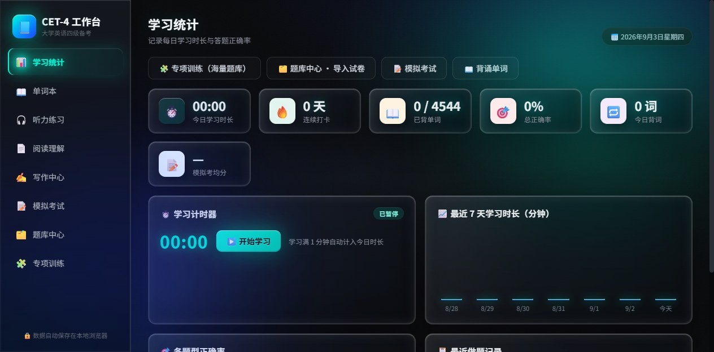
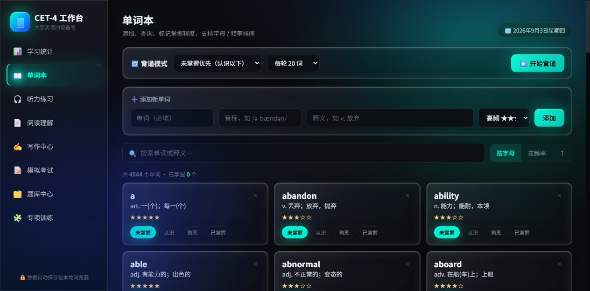
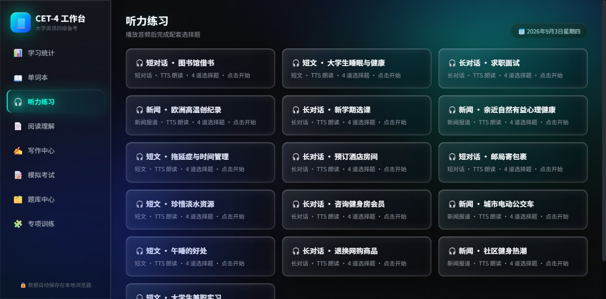
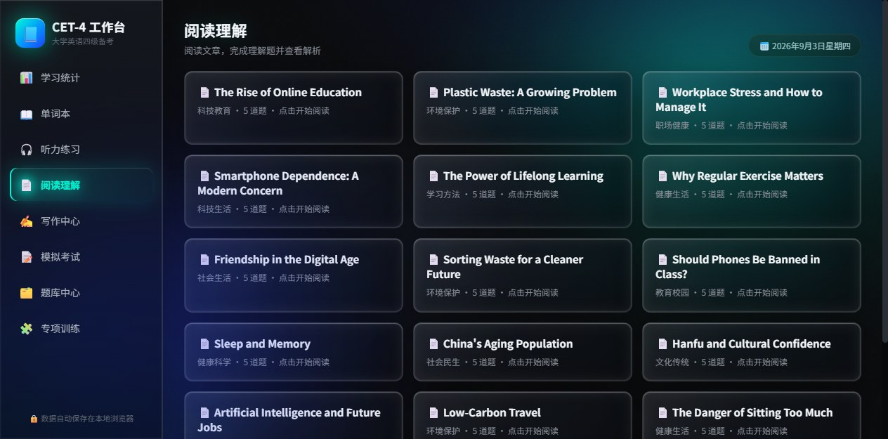
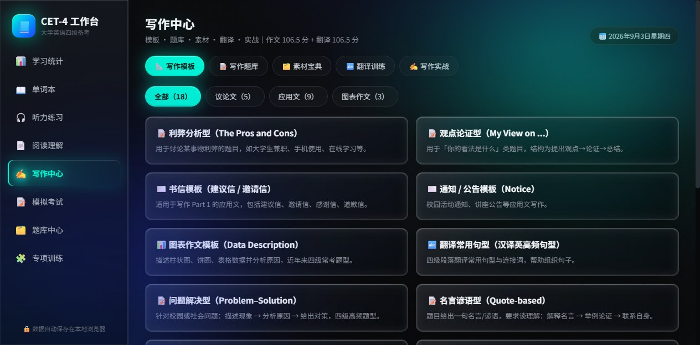
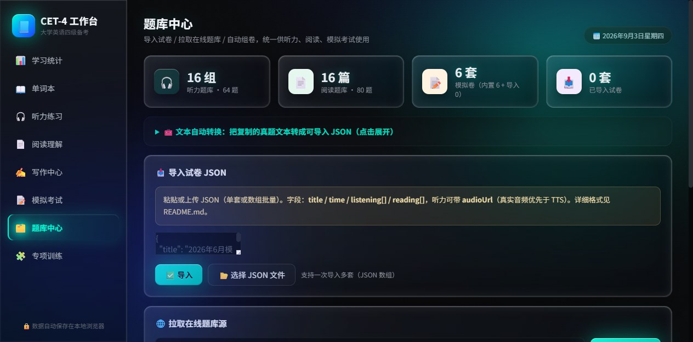
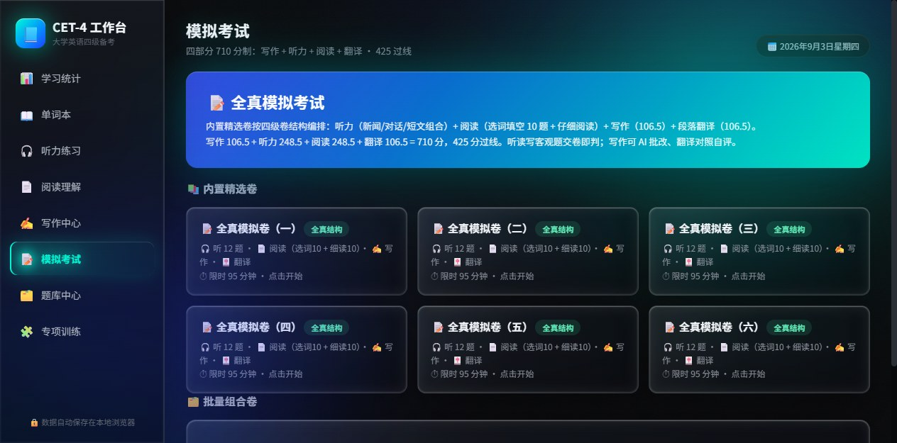
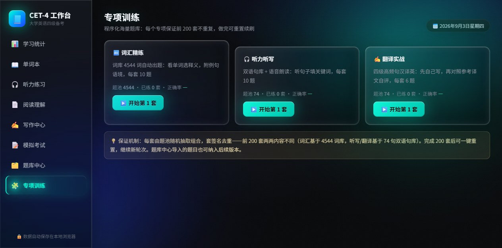

# CET-4 Workbench · 四级备考工作台

> 离线、单机、一站式的大学生英语四级备考工具。包含 **4544 词完整词库**、**四部分全真模拟考试（710 分制）**、**AI 写作批改**、**段落翻译对照**、**专项训练程序化出题**，所有数据全部保存在本地（无云端、无注册、无广告）。

[](#)
*深色电台风玻璃面板 + 霓虹辉光 UI，学习数据一目了然。*

---

## 🎯 这是什么

这是一款面向大学生 / 自学者 / 备考人群的**离线四级备考桌面应用**，把"背单词 → 做真题 → 看范文 → 写翻译 → 改作文"一整条备考路径整合到一个界面里。所有数据保存在你的电脑本地 SQLite/LocalStorage 里，**不依赖网络、不会泄露学习数据、可离线使用**。

它适合：

- ✅ 离校复习、无网络环境的同学
- ✅ 想一站式练完"听读写译"不用装 5 个 App
- ✅ 在校期间碎片化背单词 + 周末做模考
- ✅ 教师布置四级作业、希望学生能自主练习与自评

它**不**适合：

- ❌ 需要在线答题云端排行 / 同伴 PK 的场景（这是离线工具）
- ❌ 不允许使用 AI 辅助学习的考试环境

---

## 🚀 快速开始

```bash
# 推荐：国内镜像加速（可选）
set ELECTRON_MIRROR=https://npmmirror.com/mirrors/electron/
npm config set registry https://registry.npmmirror.com

# 安装依赖并启动桌面应用
npm install
npm start

# 也可直接打开根目录 index.html 在浏览器中运行（无需 Node / Electron）
```

启动后默认打开「学习统计」首页，左侧导航进入各模块。

---

## ✨ 功能详解

### 1. 📊 学习统计（首页）


- **今日学习计时器**：点开始学习后自动累计学习分钟数，今天的计时数据持久化保存
- **学习统计** 4 大指标：连续打卡天数、已背单词数、总正确率、今日背词数
- **模拟考均分** 卡：展示最后一次模拟考成绩
- **近 7 天学习时长** 柱状图：可视化每日学习分布
- **首页快捷按钮**：专项训练 / 题库中心 / 模拟考试 / 背诵单词

### 2. 📖 单词本（4544 词）



- **完整四级词库** 4544 词：英美音标 / 多义项 / 词组 / 双语例句 / 学习频次
- **搜索 + 排序**：按字母 / 词频 / 拼写 / 熟悉度筛选
- **个人词单**：支持添加自定义词汇、标记掌握 / 模糊 / 不熟 / 未学 四级状态
- **数据持久化**：所有词单、笔记、状态保存在 localStorage，浏览器/桌面端均可同步

### 3. 🎧 听力练习



- **16 组真题风听力**：短对话 / 长对话 / 短文 / 新闻四种形态，TTS 朗读原文（也可外接真实音频 URL）
- **逐题作答**：每题 4 选项，点选即时判分、对错解析、正确答案解析
- **进度统计**：显示当前组已答情况

### 4. 📄 阅读理解



- **16 篇真题阅读**：全部为真题风段落题材（科技 / 教育 / 社会 / 文化 / 环境 / 健康），3 段文章 + 5 道题
- **文章段落显示**：每段独立呈现，题目紧接下方
- **解析即时**：作答后展示正确选项、你的选择、文字解析

### 5. ✍️ 写作中心



5 个子板块一站式训练：

| 板块 | 内容 |
|---|---|
| **📐 写作模板库** | 18 个真题风模板：议论文 5 类（利弊/观点/问题解决/名言谚语/现象评论）、应用文 8 类（建议信/邀请/感谢/道歉/投诉/求职/通知/演讲/倡议/报道）、图表图文 3 类（饼图表格 / 看图） |
| **📝 写作题库** | 80 道真题风格写作题，按题型 × 话题双筛选，每题含「审题思路」折叠 |
| **🗂️ 素材宝典** | 万能开头 12 / 结尾 10 / 过渡词 6 类 / 高级替换词 40 组（important→crucial/vital/significant）/ 亮点句型 30 个 / 常见错误 TOP20 / 六大话题词汇 · 全部可一键复制 |
| **🔤 翻译训练** | 段落级汉译英 8 篇（中国文化/科技/民生），先自己译再对照参考译文 + 重点表达 |
| **✍️ 写作实战** | 30 分钟计时 + 实时字数（120–180 区间提示：不足黄/达标绿/超限红）+ 草稿保存 + **AI 按四级 15 分制多维批改**（字数/结构/句型/词汇/语法 7 维度）+ 智能预评分 |

### 6. 🗂️ 题库中心



- **试卷生成器**：从当前 16 组听力 + 16 篇阅读 + 3 篇选词填空 中**两两组合**，理论可生成 14,400 套不重复限时模拟卷，支持一键生成 200 / 500 套
- **文本→JSON 转换器**：粘贴网页真题文本（按【标题】【文章/音频】【题目】标记），自动解析为可导入 JSON
- **在线拉取**：支持从外部 JSON URL 一键导入试卷
- **批量管理**：已导入卷与组合卷分开管理，可删除 / 清空

### 7. 📝 模拟考试（四部分全真结构 710 分制）




**完全按照真实四级卷结构编排**：写作 + 听力 + 阅读 + 翻译

| 部分 | 题量 | 分值 | 说明 |
|---|---|---|---|
| 🎧 听力 | 12 题（新闻 / 对话 / 短文各 1 组） | 248.5 | 计时 95 分钟，单选作答 |
| 📄 阅读 | 20 题（选词填空 10 + 仔细阅读 2 篇 10） | 248.5 | **15 选 10 选词填空**是真题 Section A 题型 |
| ✍️ 写作 | 1 篇（120–180 词） | 106.5 | 交卷后可一键 AI 批改 7 维度 |
| 🀄 翻译 | 1 段（140–160 汉字） | 106.5 | 交卷后对照参考译文 4 档自评 |
| **合计** | **32 题 + 2 篇** | **710** | **425 过线** |

**亮点功能**：
- 6 套内置全真模拟卷，95 分钟大倒计时
- 交卷即判客观题 → 错题解析 → 选词填空错题高亮答案词
- 写作 AI 批改报告（7 维度分条 + 逐条评语）→ 采用档位并计入总分
- 翻译对照参考译文 4 档自评（100/75/50/25% 达意）→ 计入总分
- 5 张分数卡实时更新（听 / 读 / 写 / 翻 / 总），过线自动标 ✅

### 8. 🧩 专项训练（程序化海量题库）



- **词汇精练**：从 4544 词库自动抽 10 题（看单词选中文释义），干扰选项随机抽取，附单词例句语境
- **听力听写**：从双语句库听句子填关键词，TTS 朗读，词形判分
- **翻译实战**：从双语句库抽汉译英题，自评 3 档（基本正确 / 部分 / 不会）计分
- **前 200 套不重复**：每类专项训练题库通过"签名去重"机制，**前 200 套内容两两不同**，完成后可一键重置继续新轮次

---

## 📦 打包发布

```bash
npm run dist    # Windows NSIS 安装包 → release/
npm run pack    # Windows 便携版 exe（无需安装） → release/
```

打包产物可在 GitHub Releases 下载（v1.0.0 即将发布）。

---

## 🧾 试卷导入格式

题库中心的"文本→JSON 转换器"可一键粘贴真题文本生成 JSON。也支持直接导入 JSON（数组形式支持多套卷）：

```json
{
  "title": "2026年6月模拟卷",
  "time": 3600,
  "listening": [
    { "id": "L", "title": "短对话 · 购物",
      "audio": "听力原文文本（系统 TTS 朗读）",
      "audioUrl": "可选：真实音频 URL（优先生效）",
      "questions": [
        { "q": "问题文本", "options": ["A选项","B选项","C选项","D选项"], "answer": 1, "analysis": "解析文本" }
      ]
    }
  ],
  "reading": [
    { "id": "R", "title": "文章标题",
      "paragraphs": ["段落1内容","段落2内容"],
      "questions": [
        { "q": "问题文本", "options": ["A","B","C","D"], "answer": 0, "analysis": "解析文本" }
      ]
    }
  ]
}
```

`listening` / `reading` 均可省略其一。

---

## 🛠 技术栈

| 层级 | 技术 |
|---|---|
| 前端 | 原生 HTML / CSS / JS（无框架），单文件 index.html（238 KB）+ 词库 words-data.js（1.7 MB） |
| 桌面 | Electron 31.7.7（Windows / macOS / Linux 跨平台） |
| 数据 | localStorage（前端），无需后端，无需联网 |
| 打包 | electron-builder 24.13.3 |
| UI 设计 | 自研，借鉴 Mineradio 深色电台风玻璃面板 + 霓虹辉光 |

---

## 💡 设计理念

1. **离线优先**：所有数据本地保存，不上传云端，符合隐私诉求
2. **零依赖前端**：单文件 HTML 即可在浏览器直接打开使用，无需 Node / Electron
3. **AI 辅助而非替代**：AI 写作批改给的是建议与档位，你仍然决定最终分数——避免把分数"外包"给算法
4. **题型尽量贴近真考**：选词填空 15 选 10、写作 15 分制批改、翻译 106.5 自评等关键环节都对齐四级考纲
5. **风格借鉴而不复制**：UI 风格参考 Mineradio 音乐电台应用的玻璃 + 霓虹视觉，但**没有任何代码/素材复制**，所有 CSS 参数均为基于设计语言推导重写

---

## 📄 License

[MIT](LICENSE) © 2026 che59064-spec

---

## 🙏 致谢

- 词库基于多份公开四级词表人工整理合并而成
- UI 设计灵感来自 Mineradio（深色电台风）
- TTS 引擎采用浏览器原生 Web Speech API（无需联网即可朗读英文）